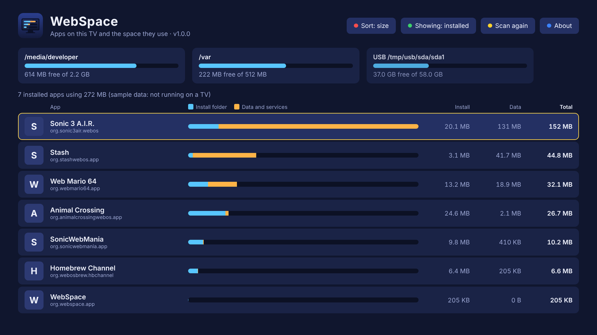

<p align="center"></p>

# WebSpace

**Version 1.0.0** · A small app for LG webOS TVs that lists the installed apps and the storage each one
uses, so you can see what is filling the TV.

- **Every app with its size:** the app's own install folder, plus the folders elsewhere that carry its
  id (its services and the data the TV keeps for it), sorted by size or by name.
- **The TV's storage:** used and free space of each of the TV's writable storage areas, and of USB
  drives.
- **Details:** OK on an app lists its folders, their sizes and the storage they are on.
- **A text report:** after every scan the list is also saved as `webspace-report.txt` in the app's own
  folder on the TV (`/media/developer/apps/usr/palm/applications/org.webspace.app/`), to read later, for
  example over SSH.
- **Made for the remote.**

<p align="center"></p>

(The screenshot shows the sample data the app uses in a desktop browser.)

## What you need

- An LG webOS TV with the [webOS Homebrew Channel](https://github.com/webosbrew/webos-homebrew-channel),
  **rooted**. Reading the folders of other apps needs root, which the app gets through the Homebrew
  Channel's service. Without root the app still lists the apps (when the TV lets it), without sizes, and
  says why.

## Install

Download the `.ipk` from the [releases](https://github.com/pustal/WebSpace/releases) and install it with
the Homebrew Channel or `ares-install`. Start **WebSpace** on the TV.

## Remote control

| Button | Does |
|---|---|
| Up / Down (Page Up / Page Down) | Move through the list; Up from the top reaches the buttons |
| Left / Right | Move along the buttons |
| OK | An app's folders, or press a button |
| Red | Sort by size or by name |
| Green | Show the installed apps, or all apps (with the built-in ones) |
| Yellow | Scan again |
| Blue | About (the project page and Ko-fi, as QR codes) |
| Back | Close a dialog, or leave the app |

## How sizes are measured

1. The apps come from webOS' application manager (`listApps`): name, id, icon, install folder, and
   whether the app is built into the firmware.
2. One root command measures every install folder with `du -skx`, and lists the folders whose name holds
   an app's id in the places webOS keeps app services and data (`/media/developer/apps/usr/palm/services`,
   `/media/cryptofs/apps/usr/palm/services`, `/var/palm/jail`, `/var/lib/webosbrew`, the web app
   manager's folders and a few more; see `EXTRA_ROOTS` in `src/scan.js`). A second command measures those.
3. The storage areas come from `/proc/mounts` and `df`.

Folders are measured on their own file system only (`du -x`), so bind mounts are never counted twice. An
app's **Install** size is its install folder (for many homebrew apps that includes the data they write
next to themselves); **Data** is everything else found for it. Data kept under a name that does not
contain the app's id (some web apps' browser storage) is not found.

## Building

```sh
npm install
npm run package        # out/org.webspace.app_<version>_all.ipk and its Homebrew Channel manifest
npm run tv:deploy      # also installs and starts it on the device "tv" (see ares-setup-device)
```

`npm run build:dev && npm run serve` serves the app on http://localhost:8080 with sample data, for working
on the screens in a desktop browser. `python3 scripts/make-icons.py` renders the icons from
`assets/icons/source/icon.svg` (needs Python Playwright and Pillow).

The app is plain JavaScript, bundled with esbuild for Chromium 53 (webOS 4 and newer):

- `src/scan.js`: listing the apps and measuring them (the root commands).
- `src/report.js`: the text report and saving it in the app's folder.
- `src/luna.js`: luna service calls and the Homebrew Channel's root `exec`.
- `src/main.js`: the screen and the remote.

## Support

If WebSpace is useful to you, you can support it on [Ko-fi](https://ko-fi.com/pustal).

## Licence

GNU GPL v3 (`LICENSE`). See `THIRD_PARTY_NOTICES.md` for the library it uses.
